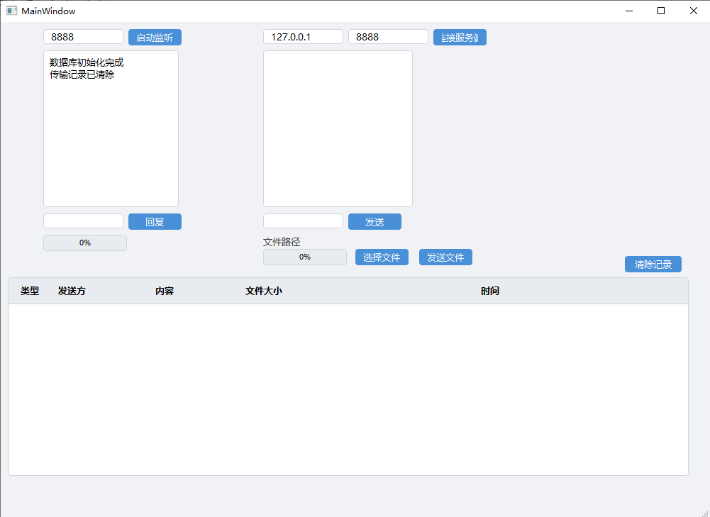

# Qt-LanTransfer

> 基于 Qt6 / C++17 的局域网文件传输与即时通讯桌面应用。
> 自定义应用层协议，子线程流式读取 + 信号量背压，传输 500MB 文件时内存峰值稳定在 70MB 以内，与文件大小无关。

## 运行截图



## 性能实测

传输 500MB 二进制文件（本机回环），优化前后进程级内存峰值：

| 进程 | 优化前 | 优化后 | 降幅 |
|------|--------|--------|------|
| 发送端 | 657.5 MB | **71.6 MB** | −89% |
| 接收端 | 554.3 MB | **43.2 MB** | −92% |

发送端 `bytesToWrite()` 水位封顶 **448 KB**，呈稳定锯齿波形：

```
448 → 320 → 256 → 192 → 256 → 320 → 448 KB
（约 1140 个周期完成 500MB 传输，周期稳定即系统处于稳态）
```

三项验收同时通过：峰值达标、日志出现「接收完成」、收发文件字节数一致（524288000 字节）。

> 测量口径：`PeakWorkingSet64`（进程度量），不是整机内存占比。
> 早期用整机内存观察，600MB 级尖峰在 16GB 基线下只占 4%，完全看不出来。

## 功能

| 模块 | 功能 | 说明 |
|------|------|------|
| 网络通信 | TCP 双向文本消息 | 客户端连接服务端后，双方可互发文本消息 |
| 文件传输 | 分片传输 + 进度条 | 自定义协议，64KB 分片，支持任意大小文件 |
| 流控 | 信号量背压 | 在途分片限制为 4 片（约 256KB），防止生产速度超过网络消费速度 |
| 传输历史 | 数据库记录 + 表格展示 | SQLite 存储，QSqlTableModel + QTableView 实时展示 |
| 多线程 | 子线程流式读取 | moveToThread 方式，主线程只写 socket，UI 不阻塞 |
| 容错 | 断线落盘 | 传输中断时保存已收数据并关闭句柄，避免半成品文件与句柄泄漏 |
| 界面美化 | QSS 全局样式 | 蓝色系配色，按钮/输入框/进度条/表格统一样式 |

## 技术栈

- **语言**：C++17
- **框架**：Qt 6（Widgets / Network / Sql）
- **构建**：qmake
- **数据库**：SQLite（QSqlDatabase + QSqlQuery + QSqlTableModel）
- **网络**：QTcpServer / QTcpSocket
- **并发**：QThread + moveToThread + QSemaphore
- **UI**：Qt Widgets

## 架构设计

### 网络协议

```
FILE:文件名:文件大小:总片数\n
CHUNK:片号\n + 64KB 二进制数据
```

接收端使用缓冲区 + 状态机循环解析，处理 TCP 粘包与半包：数据不足一片时不消费，等待下次 `readyRead` 补齐。

### 多线程与背压

`socket->write()` 是非阻塞的，它只把数据追加到内部缓冲队列，这个队列**没有上限**。因此瓶颈不在读文件速度，而在于生产者不受消费者约束。

```
┌─ 子线程 FileSender ─────────────┐      ┌─ 主线程（UI / Socket）──────────┐
│                                 │      │                                 │
│  acquire()  ← 等待空槽位        │      │                                 │
│      ↓                          │      │                                 │
│  read(64KB)                     │      │                                 │
│      ↓                          │      │                                 │
│  emit chunkReady ───────────────┼─────→│  socket->write()                │
│                                 │      │      ↓                          │
│  （4 个槽位用尽则阻塞在此，      │      │  bytesToWrite() < 256 KB ?      │
│    主线程事件循环不受影响）      │      │      ↓ 是                       │
│                                 │←─────┼── releaseSlot()  归还一个槽位   │
└─────────────────────────────────┘      └─────────────────────────────────┘
```

关键设计：**释放条件是「消费完成」，不是「写入调用返回」**。若在 `write()` 后立即释放，积压只会从 socket 缓冲转移到信号队列，问题不变。

### 目录结构

```
Qt-LanTransfer/
├── main.cpp              # 入口
├── mainwindow.h / .cpp   # 主窗口（UI + 网络 + 数据库 + 协议解析）
├── mainwindow.ui         # Qt Designer 界面文件
├── filesender.h / .cpp   # 多线程文件发送器（流式读取 + 背压）
├── transfer.db           # SQLite 数据库（运行时自动生成）
├── received/             # 接收文件目录（运行时自动创建）
└── Qt-LanTransfer.pro    # qmake 项目文件
```

## 编译运行

### 环境要求

- Qt 6.x（含 Widgets、Network、Sql 模块）
- MinGW / MSVC 编译器，或直接使用 Qt Creator

### 步骤

```bash
git clone https://github.com/xuchang1025/Qt-LanTransfer.git
cd Qt-LanTransfer
mkdir build && cd build
qmake ..
mingw32-make      # Windows MinGW
make              # Linux / macOS
```

或用 Qt Creator 打开 `Qt-LanTransfer.pro` 直接运行。

### 使用方式

1. 服务端：输入端口号 → 点击「启动监听」
2. 客户端：输入 IP 和端口 → 点击「连接服务端」
3. 发送消息：输入文字 → 点击「发送」
4. 发送文件：点击「选择文件」→ 点击「发送文件」
5. 接收文件保存在程序工作目录的 `received/` 下
6. 查看记录：窗口底部表格自动展示传输历史

## 已知限制与设计取舍

| 限制 | 说明 |
|------|------|
| 单客户端连接 | 当前服务端同时只处理一个连接。多客户端需引入会话列表与独立的接收状态机，属于结构性改动，暂不引入 |
| 无断点续传 | 协议未携带偏移量字段，中断后需整文件重传。加入需扩展协议并维护分片落盘索引 |
| 明文传输 | 定位为可信局域网内部使用，未引入 TLS |
| 固定 64KB 分片 | 未做自适应。实测回环吞吐下 64KB 已足够，若跨广域网可考虑按 RTT 调整 |
| qmake 而非 CMake | Qt6 已支持 CMake，迁移属于工程规范问题，不影响现有功能 |

## 提交历史

| 提交 | 内容 |
|------|------|
| `chore: 移除误提交的构建产物与 IDE 本地配置` | 仓库清理，被跟踪文件 427 → 11 |
| `fix: 文件发送改为流式读取` | `readAll()` 改为分片循环，内存 O(文件大小) → O(64KB) |
| `feat: 发送端加入信号量背压` | 在途上限 256KB；修复 `moveToThread` 因 parent 失效 |
| `perf: 接收端改为边收边写` | 移除整体缓存，峰值 554MB → 43MB |
